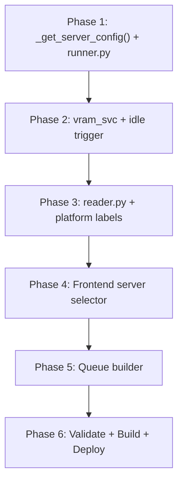

# TODO: Strata (:8090) Benchmark Support

> **Goal:** Allow the Strata inference endpoint (`:8090`) to be selected as a test server for benchmark runs in the Benchmark tab, alongside the existing Primary (`:8080`) and Secondary (`:8081`) servers.

---

## Key Differences: Strata vs llama-server

Before implementation, it's important to understand how Strata differs from the Primary/Secondary llama-server instances:

| Aspect | Primary / Secondary | Strata |
|---|---|---|
| Model listing | `GET /models` on container hostname | `GET /models` via `get_strata_url()` |
| Model loading | `POST /models/load` | `POST /v1/load` (different endpoint!) |
| Model unloading | `POST /models/unload` | `POST /v1/unload` |
| No INI file | `models.ini` / `modelg.ini` | Auto-detected from `/models` |
| VRAM tracking | Per-GPU from MQTT (`vram_percent` / `vram_percent_gtx`) | Shared with Primary (same GPU 0 — Pascal CUDA12) |
| Idle slot check | `GET /slots` → `is_processing` | ✅ Confirmed: `GET /slots` returns `200` (compatible) |
| Loaded model detection | `_get_loaded_model()` / `_get_loaded_mini_model()` | `_get_loaded_strata_model()` already exists in `chat_svc.py` |
| Container name | `llm-server` / `llm-server-mini` | `strata` |
| `touch_activity()` key | `"llama-server"` / `"llama-server-mini"` | `"strata"` (already in `llm_lifecycle.py`) |

> [!WARNING]
> Strata uses different API endpoints for model load/unload (`/v1/load` vs `/models/load`). The benchmark runner's queue task hardcodes `/models/load` — this must be made server-aware.

---

## Phase 1: Backend — `_get_server_config()` Strata Support

**File:** [`services/benchmark/runner.py`](file:///home/nui/dev/llmMobile/services/benchmark/runner.py#L92-L104)

### 1.1 Extend `_get_server_config()` to handle `"strata"`

Currently handles `"primary"` and `"secondary"`. Add a third branch:

```python
def _get_server_config(server: str = "primary") -> dict:
    if server == "strata":
        from utils.common import get_strata_url
        from services.chat_svc import _get_loaded_strata_model
        strata_url = get_strata_url()
        return {
            "server_url": strata_url,
            "chat_url": f"{strata_url}/v1/chat/completions",
            "get_loaded": _get_loaded_strata_model,
            "load_url": f"{strata_url}/v1/load",       # Different from /models/load!
            "unload_url": f"{strata_url}/v1/unload",
        }
    if server == "secondary":
        return {
            "server_url": MINI_SERVER_URL,
            "chat_url": f"{MINI_SERVER_URL}/v1/chat/completions",
            "get_loaded": _get_loaded_mini_model,
            "load_url": f"{MINI_SERVER_URL}/models/load",
            "unload_url": f"{MINI_SERVER_URL}/models/unload",
        }
    return {
        "server_url": "http://llm-server:8080",
        "chat_url": "http://llm-server:8080/v1/chat/completions",
        "get_loaded": _get_loaded_model,
        "load_url": "http://llm-server:8080/models/load",
        "unload_url": "http://llm-server:8080/models/unload",
    }
```

### 1.2 Update `run_benchmark_queue_task()` to use `cfg["load_url"]`

**Lines ~412, 437, 763:** Currently hardcodes `f"{server_url}/models/load"` for test model loading and `"http://llm-server:8080/models/load"` for judge model loading. Replace with `cfg["load_url"]`.

- [ ] Line ~412: `load_model_url = f"{server_url}/models/load"` → `load_model_url = cfg["load_url"]`
- [ ] Line ~763: Judge model load URL stays hardcoded to `http://llm-server:8080/models/load` — **confirmed**: judge is always `nemotron-labs-3-elastic` on the Primary server, regardless of test server.

### 1.3 Handle Strata model identity in queue task

Strata models have different IDs (not `.gguf` filenames). The `_clean_model_id()` and `_get_preset_id_for_model()` calls need to handle Strata model IDs gracefully.

- [ ] Verify `_get_preset_id_for_model(model_id, server_url=strata_url)` works against Strata's `/models` endpoint
- [ ] Verify `_clean_model_id()` doesn't mangle Strata model IDs (they may not follow GGUF naming conventions)

---

## Phase 2: Backend — VRAM & Idle Trigger for Strata

**File:** [`services/vram_svc.py`](file:///home/nui/dev/llmMobile/services/vram_svc.py)

### 2.1 Add Strata to `get_model_vram_gb()`

Strata runs on the same GPU as Primary (GPU 0 — Pascal CUDA12). The VRAM reading should use the same source as Primary's VRAM.

- [ ] Add `elif server == "strata":` case that mirrors Primary's logic (same GPU)
- [ ] Set `vram_total` appropriately (same as Primary's total — 16 GB for P100, or whatever system RAM Strata uses)

### 2.2 Add Strata to `wait_for_idle_trigger()`

Currently checks `/slots` on `llm-server` or `llm-server-mini`. Strata may or may not support `/slots`.

- [ ] **Investigate**: Does Strata expose a `/slots` endpoint? If not, implement a simpler health-check fallback (e.g., just poll `/models` for loaded status, or use a time-based delay)
- [ ] Add `elif server == "strata": base_url = get_strata_url()` branch

### 2.3 Guard LLM idle-unload against strata benchmarks

**File:** [`services/llm_lifecycle.py`](file:///home/nui/dev/llmMobile/services/llm_lifecycle.py)

- [ ] The idle unload watchdog should not unload Strata models while a benchmark is in progress on `server="strata"`. Verify that `_benchmark_running` guard already covers this.

---

## Phase 3: Backend — Reader & Aggregation

### 3.1 Add Strata platform label

**File:** [`services/benchmark/reader.py`](file:///home/nui/dev/llmMobile/services/benchmark/reader.py#L22-L25)

```python
_PLATFORM_LABELS = {
    "primary": "Tesla P100 (16GB)",
    "secondary": "GTX 1060 (6GB)",
    "strata": "Strata (Pascal CUDA12)",  # ← Add this
}
```

### 3.2 Append untested Strata models to benchmark listing

**File:** [`services/benchmark/reader.py`](file:///home/nui/dev/llmMobile/services/benchmark/reader.py#L324-L374)

Currently only appends untested models from `models.ini` and `modelg.ini`. For Strata, there's no INI file — models must be fetched from the Strata `/models` endpoint.

- [ ] After the INI loop, call `list_strata_models()` (from `model_svc.py`) to get available Strata models
- [ ] Append untested Strata models with `server: "strata"`, `is_ready: True`, `in_strata: True`
- [ ] Add a new flag `in_strata` to benchmark model entries (similar to `in_models_ini` / `in_modelg_ini`)

### 3.3 Update server filter in `get_benchmarks()`

**File:** [`services/benchmark/reader.py`](file:///home/nui/dev/llmMobile/services/benchmark/reader.py#L376-L381)

- [ ] Add `elif s_low == "strata": benchmarks = [b for b in benchmarks if b.get("in_strata")]`

### 3.4 VRAM total for Strata benchmarks

**File:** [`services/benchmark/reader.py`](file:///home/nui/dev/llmMobile/services/benchmark/reader.py#L287)

- [ ] Currently `vram_total = 16.0 if bench_server == "primary" else 6.0` — add Strata case. Strata shares GPU 0 with Primary, so likely 16.0 GB. Consider making this a lookup dict.

---

## Phase 4: Frontend — Server Selector UI

### 4.1 Add Strata pill to Test Server selector

**File:** [`src/components/benchmark-tab/_templates.js`](file:///home/nui/dev/llmMobile/src/components/benchmark-tab/_templates.js#L159-L164)

- [ ] Add a third button after the Secondary pill:
```html
<button style="..." @click="${() => { ctx.selectedBenchmarkServer = 'strata'; fetchActiveModelId(ctx); }}">Strata (Pascal)</button>
```
- [ ] Style consistently with the existing Primary/Secondary pills

### 4.2 Update `fetchActiveModelId()` for Strata

**File:** [`src/components/benchmark-tab/_logic.js`](file:///home/nui/dev/llmMobile/src/components/benchmark-tab/_logic.js#L65-L82)

Currently uses `/api/llm-mini/models` for secondary and `/api/llm/models` for primary. Add Strata:

```javascript
export async function fetchActiveModelId(ctx) {
  try {
    const endpoint = ctx.selectedBenchmarkServer === 'secondary' ? '/api/llm-mini/models'
                   : ctx.selectedBenchmarkServer === 'strata' ? '/api/llm-strata/models'
                   : '/api/llm/models';
    // ... rest stays the same
```

### 4.3 Add Strata filter pill to results table

**File:** [`src/components/benchmark-tab/_templates.js`](file:///home/nui/dev/llmMobile/src/components/benchmark-tab/_templates.js#L297-L298)

- [ ] Add a `Strata` pill alongside the existing Primary / Secondary filter pills

### 4.4 Update `getFilteredAndSortedBenchmarks()` for Strata

**File:** [`src/components/benchmark-tab/_logic.js`](file:///home/nui/dev/llmMobile/src/components/benchmark-tab/_logic.js#L273-L321)

- [ ] Add `else if (filter === 'strata') { list = list.filter(b => b.in_strata ?? (b.server === 'strata')); }`
- [ ] Update the `'all'` filter to include Strata models

### 4.5 Strata server badge in results table

**File:** [`src/components/benchmark-tab/_templates.js`](file:///home/nui/dev/llmMobile/src/components/benchmark-tab/_templates.js#L382)

- [ ] Add a third badge style for `b.server === 'strata'` (e.g., blue/purple: `🔵 Strata`)

---

## Phase 5: Frontend — Queue Builder Strata Model List

### 5.1 Strata models in the queue builder checkbox table

The benchmark queue builder shows models from the selected server's model list. When Strata is selected, it should show Strata models from `/api/llm-strata/models` (or from `list_strata_models()`).

- [ ] Ensure `benchmarks[]` data (from `get_benchmarks()`) already includes Strata models (done in Phase 3.2)
- [ ] The queue checkboxes already read from `benchmarks` filtered by platform — verify the filter works with the new `in_strata` flag

---

## Phase 6: Validation & Build

### 6.1 Pydantic schema validation

**File:** [`models/requests.py`](file:///home/nui/dev/llmMobile/models/requests.py#L44-L58)

- [ ] The `server` field in `BenchmarkRunRequest` and `BenchmarkQueueRequest` already accepts any string (`str = "primary"`). No schema change needed, but consider adding a validator for `Literal["primary", "secondary", "strata"]` for safety.

### 6.2 Database compatibility

- [ ] The `test_runs.server` column is a free-text field. Storing `"strata"` requires no schema migration.
- [ ] Verify aggregation (`calculate_and_store_model_aggregates`) works correctly for Strata runs

### 6.3 Build & test

- [ ] Run `npm run build` to validate Lit/Vite compilation
- [ ] Bump `CACHE_NAME` in `public/sw.js`
- [ ] Docker rebuild: `docker compose build llm-mobile && docker compose up -d --no-deps llm-mobile`

---

## Implementation Order



> [!IMPORTANT]
> The trickiest part is **Phase 1.2** — the queue task hardcodes model load URLs and must be refactored to use the server config dict. The judge model loading should remain on the primary server regardless of test server.

> [!NOTE]
> Strata and Primary share the same GPU (GPU 0). Running benchmarks on Strata while a model is loaded on Primary will compete for VRAM. Consider adding a warning in the UI, or unloading the Primary model before Strata benchmarks.

---

## Risk Considerations

1. **VRAM contention**: Strata and Primary share GPU 0. A benchmark on Strata may OOM if Primary has a model loaded.
2. **No `/slots` API**: If Strata doesn't expose `/slots`, `wait_for_idle_trigger()` will fail. Need a fallback.
3. **Model ID format**: Strata model IDs may not follow the `*.gguf` convention that `_clean_model_id()` expects.
4. **No INI file**: Strata models are dynamically discovered, not INI-configured. This changes how "untested" models are enumerated.
